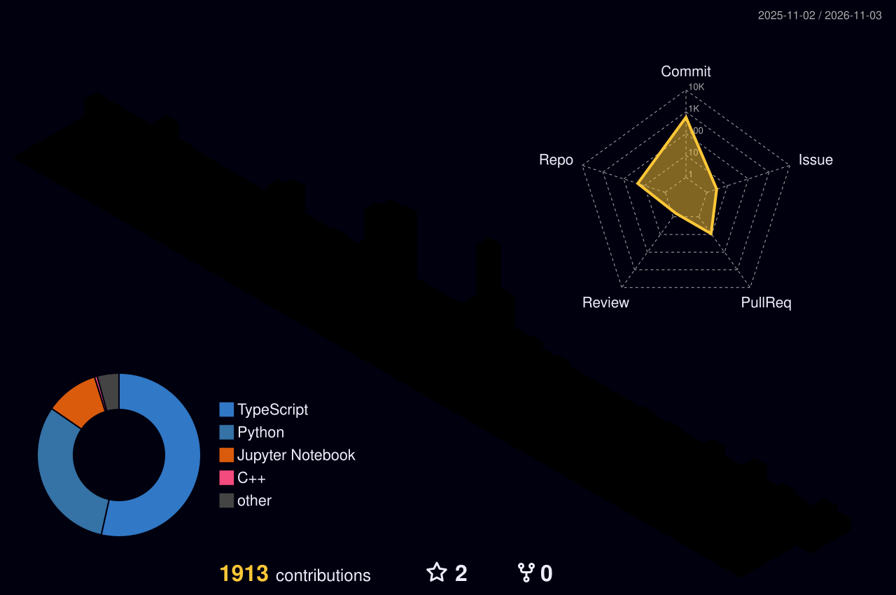

---

### About

Computer Science student at McGill University, based in Montreal. I like to learn.

---

### Tech Stack

  

---

### Experience

| Role | Organization | Location | Period |
|------|--------------|----------|--------|
| Full-Stack Software Engineer | SNA GZ | Paris, France | May - Aug 2025 |

---

### Projects

**[Rocket Science World Model Codec](https://github.com/Achraf921/RocketScience-World-Model-Codec)** - 124M parameter reproduction of the learned codec from the MIRA multi-agent world model paper (General Intuition, Kyutai, Epic Games), taking pixel frames into latent space and back. Frozen DINOv3-L encoder with a learned layer-mixing layer in place of the paper's fixed mean, and a ViViT decoder written from scratch with spatial self-attention and causal time attention. Trained on 42k Rocket League replays on an A100, weights on Hugging Face. PyTorch.

**[CodeML 2026 ViT](https://github.com/Achraf921/CodeML-2026-ViT)** - Vision Transformer built from scratch for the L2C challenge at CodeML 2026: parse building engineering plans and flag where the contractor's shop drawing diverges from them. The content is symbols laid out in grids rather than text, so OCR was off the table. 6 blocks, RoPE embeddings, DINOv3-convnext stem to squeeze some transfer learning out of a 4-plan dataset. PyTorch.

**[Pleco](https://getpleco.net/en#top)** - Commercialized SaaS for digital loyalty programs (points or stamps) living in the Apple and Google wallet, serving 7000+ end users. A Kafka based pipeline delivers 7000+ server expensive pass notifications in sub-minute time. Revenue generating, sold door to door to small businesses. NestJS, Redis, Kafka, Docker, PostgreSQL.

---

### GitHub Stats

<!-- 3D Contribution Graph - requires GitHub Action setup -->

  

<!-- Snake Animation - requires GitHub Action setup -->

<picture>
  <source media="(prefers-color-scheme: dark)" srcset="https://raw.githubusercontent.com/Achraf921/Achraf921/output/github-snake-dark.svg" />
  <source media="(prefers-color-scheme: light)" srcset="https://raw.githubusercontent.com/Achraf921/Achraf921/output/github-snake.svg" />
  
</picture>

---

### Education

**B.Sc. Honours Computer Science, Minor in Statistics** - McGill University, Montreal (2024-2027)

**French Baccalauréat** - Lycée Privé Montalembert - Specialities: Mathematics, Physics-Chemistry (18/20 and 19/20 respectively)

---

### Languages

English · French · Darija
